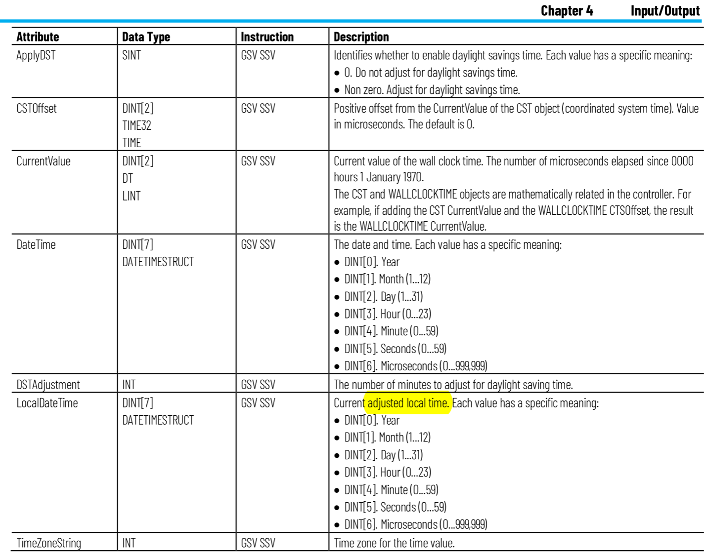

# GSV - GET SYSTEM VALUE

Requires a ONE-SHOT (ONS) to prevent storing data every scan cycle

```text
      CAPTURE        ONS          GSV        
|------|   |--------[   ]-------{     }------|
```

- Requires an Array of DINT[7] to store WallClockTime data
- LocalDateTime attribute is the better option


