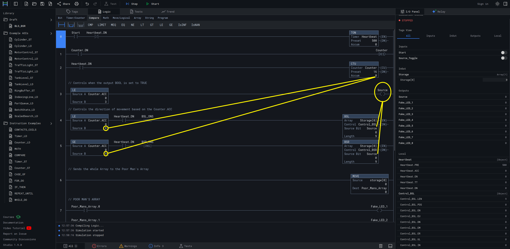

# BSL / BSR Instruction

Bit Shift Left (BSL) and Bit Shift Right (BSR) instructions are used to move data within a register or array of bits. They are particularly useful for tracking products, sequencing operations, managing outputs, and monitoring machine conditions.

Think of them as moving a series of ON/OFF bits one position at a time.

Common applications:
- Tracking products moving along a conveyor.
- Following a part through multiple manufacturing stations.
- Sequencing machine operations.
- Tracking inspection results.
- Creating a running history of machine events.

## EXAMPLE: "3-bit Bounce"

- Comparison turns the Source bit true/false
- Comparisons control the direction of flow

---

[Credit: Studio.Rungs.Dev](http://studio.rungs.dev)

---

### IN STUDIO 5000
- the CONTROL tag is the same tag used for both instructions
    - It is not two separate tags
