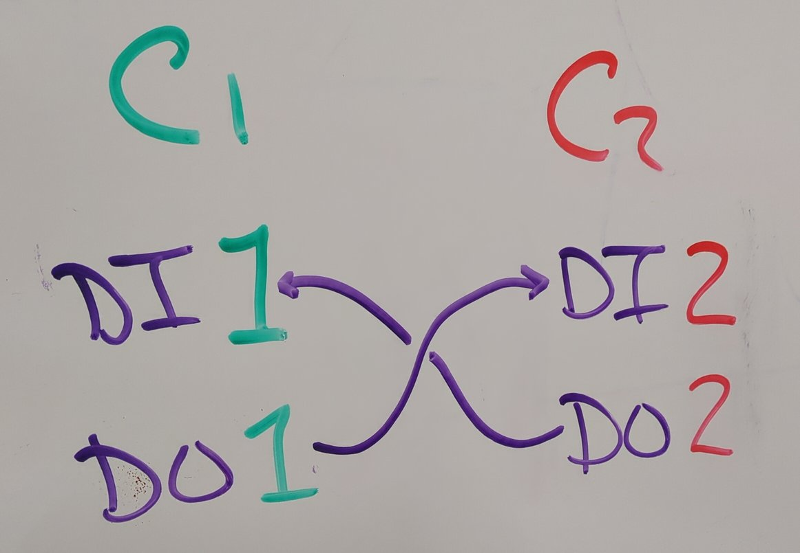
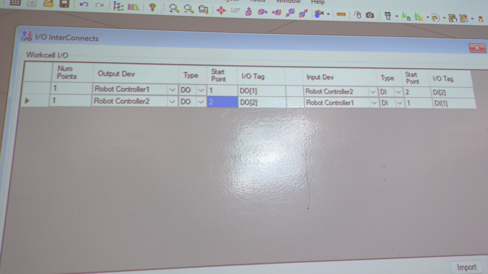

# ADVANCED PROGRAMMING CONFIGURATION II

>Use the Adv Prog Config routine for this demo.

- **DO NOT** use SERIALIZE WIZARD. It will add a BLANK robot!

## Clone a full Robot model
Right-click C:1 Robot Controller > Add Robot > Add Robot Clone
- Accept default location parameters.
- Properly configured DI and DO interface

## Cell > I/O Interconnections > Work-cell I/O
- Controller 1 DO[1] > Controller 2 DI[2]
- Controller 2 DO[2] > Controller 1 DI[1]



- Robot 1 uses number 1 for I/O
- Robot 2 uses number 2 for I/O
- This makes connections in the TP easy to remember



## Control a Robot remotely with Digital Inputs

WHEN USING MANUAL I/O CONTROL
- ROBOT 1: WAIT **DI[1] = ON**
- ROBOT 2: Just toggle **DO[1]** from IO screen
    - Monitor Ins and Outs via Split Screen

AUTOMATED ROUTINES
- See Codes below:

## ROBOT 1 ROUTINE
```
!SETUP
- OVERRIDE = 25%
- DO[1: signal to Robot 2] = OFF
- R[1: Counter] = 0

!READY + APPROACH POSITION
LBL [50]
- P[1] READY position
- P[2] APPROACH position
- WAIT DI[1: signal from Robot 2] = ON

!MAIN
LBL [100]
- P[3], P[4], P[5], P[6], P[3]
- R[1: Counter] = R[1: Counter] + 1
- IF R[1: Counter] >= 3, JMP LBL [999]
- JMP LBL [100]

!ERRORS
LBL [900]
- Removed for this exercise.


!END OF LINE
LBL [999]
- P[7] SAFE position

- R[7:Month] = ($SYS_TIME.$MONTH)
- R[8:Day] = ($SYS_TIME.$DAY)
- R[9:Hour] = ($SYS_TIME.$HOUR)
- R[10:Minute] = ($SYS_TIME.$MINUTE)

- DO[1: signal to Robot 2] = ON
- WAIT 1 sec
- DO[1: signal to Robot 2] = OFF
- WAIT 1 sec
- JMP LBL [50] to wait for Robot 2
```

## ROBOT 2 ROUTINE
This code is very simple:

```
LBL [100]

WAIT 2 sec
DO[2: signal to Robot 1] = ON
WAIT 2 sec
DO[2: signal to Robot 1] = OFF 

WAIT DI[2: signal from Robot 1] = ON

JMP LBL [100]
```

>The 2 sec WAIT gives the simulation time to catch up

---

NOTE
- Adjust the default TIMEOUT to 1000 (10 seconds)

## VIDEO REFERENCE
- Adv-Configs-1
- Adv-Configs-2
