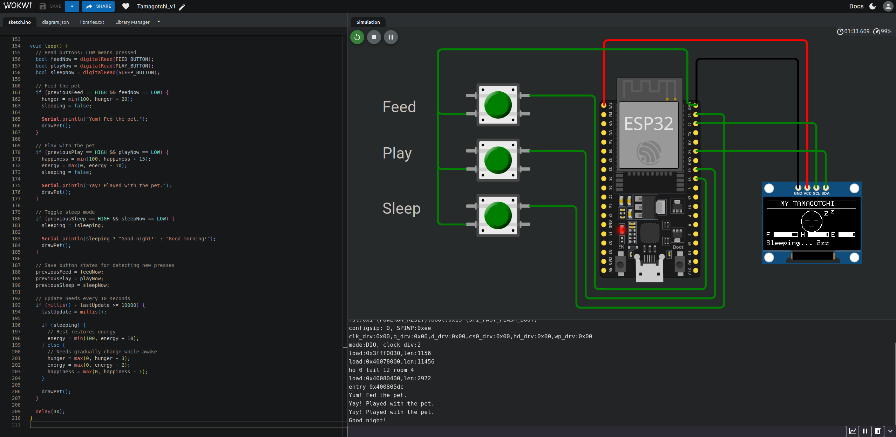

# SIMPLE TAMAGOTCHI PROJECT

Simulation via [Wokwi](http://www.wokwi.com)



## HARDWARE

- ESP32 DevMod
- SSD1306 OLED screen 128x64 pixel resolution
- (3) Push-buttons

## CODE
```text
#include <Wire.h>
#include <Adafruit_GFX.h>
#include <Adafruit_SSD1306.h>

#define SCREEN_WIDTH 128
#define SCREEN_HEIGHT 64
#define OLED_RESET -1

Adafruit_SSD1306 display(
  SCREEN_WIDTH, SCREEN_HEIGHT, &Wire, OLED_RESET
);

// ESP32 button pins
const int FEED_BUTTON = 18;
const int PLAY_BUTTON = 19;
const int SLEEP_BUTTON = 23;

// Pet stats: 0 to 100
// Hunger represents fullness: 100 = full, 0 = hungry
int hunger = 70;
int happiness = 70;
int energy = 70;

unsigned long lastUpdate = 0;

bool sleeping = false;

bool previousFeed = HIGH;
bool previousPlay = HIGH;
bool previousSleep = HIGH;

// Draw the pet and status bars
void drawPet() {
  display.clearDisplay();
  display.setTextColor(SSD1306_WHITE);
  display.setTextSize(1);

  // Title
  display.setCursor(20, 0);
  display.print("MY TAMAGOTCHI");
  display.drawLine(0, 10, 127, 10, SSD1306_WHITE);

  // Pet face
  display.drawCircle(64, 29, 15, SSD1306_WHITE);

  if (sleeping) {
    // Closed eyes
    display.drawLine(55, 27, 60, 27, SSD1306_WHITE);
    display.drawLine(68, 27, 73, 27, SSD1306_WHITE);

    // Zzz
    display.setCursor(83, 15);
    display.print("Z");
    display.setCursor(92, 11);
    display.print("z");

    // Sleeping mouth
    display.drawLine(61, 35, 67, 35, SSD1306_WHITE);

  } else {
    // Open eyes
    display.fillCircle(58, 26, 2, SSD1306_WHITE);
    display.fillCircle(70, 26, 2, SSD1306_WHITE);

    // Facial expression
    if (hunger < 25 || happiness < 25) {
      // Sad mouth
      display.drawLine(59, 37, 64, 33, SSD1306_WHITE);
      display.drawLine(64, 33, 69, 37, SSD1306_WHITE);
    } else {
      // Happy mouth
      display.drawLine(59, 33, 64, 37, SSD1306_WHITE);
      display.drawLine(64, 37, 69, 33, SSD1306_WHITE);
    }
  }

  // Status bars
  // F = fullness, H = happiness, E = energy

  // Fullness bar
  display.setCursor(0, 44);
  display.print("F");
  display.drawRect(10, 44, 35, 7, SSD1306_WHITE);
  display.fillRect(
    11, 45, hunger * 33 / 100, 5, SSD1306_WHITE
  );

  // Happiness bar
  display.setCursor(49, 44);
  display.print("H");
  display.drawRect(59, 44, 30, 7, SSD1306_WHITE);
  display.fillRect(
    60, 45, happiness * 28 / 100, 5, SSD1306_WHITE
  );

  // Energy bar
  display.setCursor(93, 44);
  display.print("E");
  display.drawRect(103, 44, 24, 7, SSD1306_WHITE);
  display.fillRect(
    104, 45, energy * 22 / 100, 5, SSD1306_WHITE
  );

  // Status message
  display.setCursor(0, 56);

  if (sleeping) {
    display.print("Sleeping... Zzz");
  } else if (hunger < 25) {
    display.print("I'm hungry!");
  } else if (happiness < 25) {
    display.print("Play with me!");
  } else if (energy < 20) {
    display.print("I'm tired!");
  } else {
    display.print("I'm Happy!");
  }

  display.display();
}

void setup() {
  Serial.begin(115200);

  // Buttons use internal pull-up resistors
  pinMode(FEED_BUTTON, INPUT_PULLUP);
  pinMode(PLAY_BUTTON, INPUT_PULLUP);
  pinMode(SLEEP_BUTTON, INPUT_PULLUP);

  // OLED I2C connections
  Wire.begin(21, 22);

  if (!display.begin(SSD1306_SWITCHCAPVCC, 0x3C)) {
    Serial.println("OLED not found!");
    while (true) {
      delay(10);
    }
  }

  display.clearDisplay();
  display.setTextSize(1);
  display.setTextColor(SSD1306_WHITE);
  display.setCursor(15, 25);
  display.println("Hello, little pet!");
  display.display();

  delay(1500);

  drawPet();
  lastUpdate = millis();
}

void loop() {
  // Read buttons: LOW means pressed
  bool feedNow = digitalRead(FEED_BUTTON);
  bool playNow = digitalRead(PLAY_BUTTON);
  bool sleepNow = digitalRead(SLEEP_BUTTON);

  // Feed the pet
  if (previousFeed == HIGH && feedNow == LOW) {
    hunger = min(100, hunger + 20);
    sleeping = false;

    Serial.println("Yum! Fed the pet.");
    drawPet();
  }

  // Play with the pet
  if (previousPlay == HIGH && playNow == LOW) {
    happiness = min(100, happiness + 15);
    energy = max(0, energy - 10);
    sleeping = false;

    Serial.println("Yay! Played with the pet.");
    drawPet();
  }

  // Toggle sleep mode
  if (previousSleep == HIGH && sleepNow == LOW) {
    sleeping = !sleeping;

    Serial.println(sleeping ? "Good night!" : "Good morning!");
    drawPet();
  }

  // Save button states for detecting new presses
  previousFeed = feedNow;
  previousPlay = playNow;
  previousSleep = sleepNow;

  // Update needs every 10 seconds
  if (millis() - lastUpdate >= 10000) {
    lastUpdate = millis();

    if (sleeping) {
      // Rest restores energy
      energy = min(100, energy + 10);
    } else {
      // Needs gradually change while awake
      hunger = max(0, hunger - 3);
      energy = max(0, energy - 2);
      happiness = max(0, happiness - 1);
    }

    drawPet();
  }

  delay(30);
}
```
